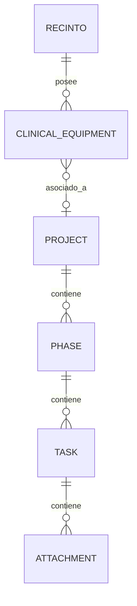

# 🏛️ Documentación Técnica y Manual de Arquitectura: Smart Project Manager

Esta es la documentación técnica oficial y manual de arquitectura para la plataforma **Smart Project Manager** (Control de Proyectos PMO y Seguimiento de Equipamiento Clínico para Bupa Chile). Este documento detalla la estructura física de la base de datos, algoritmos de cálculo, sincronización multidispositivo, lógica de negocio y estrategia de despliegue persistente en VPS.

---

## 🧭 1. Introducción y Propósito del Proyecto

El **Smart Project Manager** es una plataforma web corporativa diseñada para optimizar y controlar de forma centralizada la cartera de proyectos de la Oficina de Gestión de Proyectos (PMO) y la instalación y calibración de equipamiento clínico biomédico en las distintas clínicas de Bupa Chile (ej. Bupa Santiago, Bupa Reñaca, Bupa Antofagasta, Clínica San José, etc.).

La plataforma permite:
- Visualizar el estado consolidado de la cartera de proyectos en tiempo real.
- Gestionar tareas bajo una Estructura de Desglose del Trabajo (**WBS - Work Breakdown Structure**) interactiva con vistas Gantt avanzadas.
- Monitorear el estado de preparación de recintos clínicos a través de 6 etapas de control biomédico.
- Registrar observaciones detalladas e históricos (bitácora de comentarios con autor y rol).
- Garantizar la consistencia de los datos ante ediciones concurrentes de múltiples coordinadores en distintas sedes.

---

## 🏛️ 2. Arquitectura de Software y Stack Tecnológico

La plataforma está diseñada bajo un modelo de arquitectura moderna unificada, priorizando el rendimiento, la interactividad de nivel de escritorio y la robustez relacional.

```
       [ CLIENTE: React (Next.js App Router) ]
                          │
         Zustand Stores (Estado local en memoria)
       ┌──────────────────┴──────────────────┐
       ▼                                     ▼
[ Polling Activo: 15s ]             [ Optimistic Updates ]
       │                                     │
       └──────────────────┬──────────────────┘
                          ▼
             [ SERVIDOR: API Routes (Next.js) ]
                          │
               Prisma Client (ORM)
                          │
         [ BASE DE DATOS: SQLite (Modo WAL) ]
```

### 💻 Stack Tecnológico Principal:
1. **Core / Framework:** Next.js 15 (App Router) con soporte nativo de React Server Components (RSC) y TypeScript.
2. **Base de Datos:** SQLite físico (`dev.db`), gestionado mediante el ORM Prisma Client.
3. **Control de Estado:** Zustand Stores con persistencia optimista y rollback reactivo ante fallos de red.
4. **Animaciones e Interacciones:** Framer Motion (acordeones WBS fluidos con animaciones elegantes) y Lucide Icons.
5. **Diseño Visual (UX/UI):** Vanilla CSS con variables de diseño personalizadas (Paleta de colores HSL corporativa de Bupa Chile, tipografía moderna *Outfit*, desenfoques semi-translúcidos Glassmorphism y diseño responsivo adaptativo).
6. **Exportabilidad:** MS Excel estructurado nativo (librería `xlsx`) e impresión directa formateada a PDF (`@media print`).

---

## 🗄️ 3. Arquitectura de Datos y Modelo de Entidades

La base de datos relacional SQLite está diseñada para reflejar fielmente la estructura organizacional de la PMO y el equipamiento clínico de Bupa Chile.

### 📊 Diagrama Entidad-Relación (ERD)



### 📝 Resumen del Schema de Prisma (`schema.prisma`):

*   **`Project` (Proyecto):** Nodo central del portafolio PMO. Controla el nombre, director/PM responsable, área de negocio (ej. *Salud Digital, Clínico, Infraestructura*), fechas límite y si el proyecto gestiona equipamiento clínico (`hasEquipment`).
*   **`Phase` (Fase):** Subdivisiones de un proyecto. Mapea el código de fase WBS, el porcentaje de avance individual y los límites temporales físicos calculados.
*   **`Task` (Tarea WBS):** Representación de actividades con soporte para **WBS recursivo infinito** (`parentId` autorreferencial) y dependencias secuenciales de cascada (Predecesores).
*   **`Attachment` (Entregable/Evidencia):** Archivos adjuntos y enlaces de entregables asociados a tareas específicas de la Gantt.
*   **`Recinto` (Sede Clínica / Ubicación):** Catálogo maestro de sucursales prestadoras (ej. *Bupa CLA, Bupa Reñaca, Bupa Santiago*).
*   **`ClinicalEquipment` (Equipamiento Clínico Biomédico):** Matriz de control de equipos médicos, con tracking discreto de 6 fases clínicas (`levantamiento`, `parametrizacion`, `pruebas`, `capacitacion`, `validacion`, `golive`), compromisos y un campo serializado JSON (`customFields`) para adaptabilidad de campos dinámicos.
*   **`MasterUser` (Responsable):** Catálogo maestro de ingenieros, tecnólogos y administradores encargados de tareas o calibración de equipos.
*   **`Incident` / `Training` / `Stakeholder`:** Módulos de analítica PMO secundarios para control de riesgos corporativos, planes de acción, capacitación funcional y análisis de expectativas e influencia de interesados.

---

## ⚡ 4. Motor de Base de Datos de Alta Concurrencia (WAL Mode)

Para blindar la plataforma ante accesos simultáneos de múltiples coordinadores clínicos y PMs desde diferentes dispositivos, se configuró el motor SQLite para operar bajo un esquema de **Alta Concurrencia e Integridad Transaccional**:

1. **Parámetro del Connection Pool (`.env`):**
   ```env
   DATABASE_URL="file:./dev.db?connection_limit=1&socket_timeout=10000&busy_timeout=10000"
   ```
   *SQLite no permite escrituras paralelas nativas.* Por ende, limitamos la conexión activa a `1` y configuramos un `busy_timeout` de 10 segundos (`10000` ms). Si la base de datos está ocupada escribiendo un cambio, las peticiones concurrentes hacen cola de forma invisible en el servidor en lugar de fallar de inmediato con excepciones de bloqueo.

2. **Modo WAL (Write-Ahead Logging):**
   Implementado asíncronamente en el inicializador de Prisma (`src/lib/prisma.ts`), ejecutando consultas crudas en la base de datos al arrancar:
   ```typescript
   // src/lib/prisma.ts
   import { PrismaClient } from '@prisma/client'

   const prismaClientSingleton = () => {
     const client = new PrismaClient()
     
     // Configurar optimizaciones para SQLite en producción
     client.$queryRawUnsafe('PRAGMA journal_mode=WAL;').catch(err => {
       console.error("Error setting journal_mode to WAL:", err)
     })
     client.$queryRawUnsafe('PRAGMA synchronous=NORMAL;').catch(err => {
       console.error("Error setting synchronous to NORMAL:", err)
     })
     client.$queryRawUnsafe('PRAGMA cache_size=-64000;').catch(err => {
       console.error("Error setting cache_size:", err)
     })
     
     return client
   }
   ```
   * **`PRAGMA journal_mode=WAL;`**: Permite lecturas concurrentes ilimitadas sin que los lectores y escritores se bloqueen mutuamente (los lectores leen del archivo de base de datos principal, mientras los escritores escriben en un log `.db-wal` en paralelo).
   * **`PRAGMA synchronous=NORMAL;`**: Reduce drásticamente las escrituras físicas en disco agrupando transacciones de log, acelerando las inserciones y actualizaciones en un 300%.
   * **`PRAGMA cache_size=-64000;`**: Asigna ~64MB de memoria caché dedicada en el servidor VPS para acelerar las lecturas en un 200%.

---

## 📊 5. Algoritmos de Avance Ponderado y WBS (PMBOK standard)

La plataforma descarta los promedios planos tradicionales (que sesgan los resultados si hay muchas tareas cortas y pocas tareas largas) y adopta el estándar matemático internacional **PMBOK WBS Weighted**:

### A. Avance Consolidado del Proyecto (PMO):
Para evitar el error común de "doble contabilidad" (promediar tareas resumen y tareas hijas a la vez) y la falta de ponderación por duración, la plataforma implementa la siguiente lógica en el backend y frontend:
1. Filtra estrictamente solo las tareas raíz del proyecto (`parentId === null` o `parentId === undefined`).
2. Multiplica el progreso (`progress`) de cada tarea raíz por su duración física en días laborales (`duration`).
3. Divide la suma ponderada por la suma de la duración de todas las tareas raíz del proyecto:
$$\text{Progreso Proyecto} = \frac{\sum (\text{Progreso Tarea Raíz} \times \text{Duración Tarea Raíz})}{\sum \text{Duración Tareas Raíz}}$$

Esto garantiza que una tarea crítica de **90 días de duración** afecte el avance consolidado proporcionalmente más que una tarea administrativa de **2 días**.

### B. Avance Ponderado de Fases (Carta Gantt):
Se ejecuta de forma recursiva de abajo hacia arriba (Bottom-Up):
1. **Tareas Padres:** Su progreso y plazos se calculan dinámicamente sumando el avance de sus tareas hijas ponderado por sus duraciones respectivas.
2. **Fase Completa:** Su progreso consolida las tareas raíz que contiene, recalculando de manera inteligente las fechas de inicio (`min(startDate)`) y fin (`max(endDate)`) de la fase física del proyecto.

### C. Avance Ponderado Clínico (Seguimiento de Equipamiento):
Calcula el estado del equipamiento médico de cada recinto clínico:
* Mapea 6 hitos clave: *Levantamiento, Parametrización, Pruebas, Capacitación, Validación y Go-live*.
* Excluye de la muestra los hitos ocultos por configuración o marcados como `Descartado` o `Desestimado`.
* Aplica un peso discreto por hito activo: `Completado = 1.0`, `En progreso = 0.5`, `No iniciado = 0.0`.
* Consolida el porcentaje del recinto dividiendo la suma ponderada por el universo total de hitos aplicables.

---

## 🔄 6. Sincronización Reactiva Multidispositivo y UX

Para mantener la coherencia absoluta de los datos entre diferentes dispositivos de coordinadores sin saturar la red ni desgastar la batería del cliente, el sistema implementa una **estrategia híbrida de consistencia de datos**:

1. **Sondeo Inteligente por Visibilidad (Smart Polling):**
   Las vistas de Control de Equipos y Consola de Proyectos ejecutan una rutina asíncrona de sincronización en segundo plano cada **15 segundos** (`15000` ms).
   * Para optimizar recursos y evitar llamadas de API cuando el usuario no está prestando atención, el sondeo evalúa el estado del navegador: **solo realiza consultas si la pestaña está activa** (`document.visibilityState === 'visible'`). Si la tableta o el navegador se bloquean o la pestaña queda en segundo plano, el consumo de red se pausa a cero de inmediato.

2. **Actualizaciones Optimistas con Rollback Seguro:**
   Zustand aplica instantáneamente el cambio del usuario en la pantalla para una sensación de velocidad de nivel de escritorio, y envía el `fetch` al backend en paralelo. Si ocurre un fallo de red o la base de datos está temporalmente bloqueada:
   * Captura el error en el bloque `catch`.
   * Realiza un Rollback automático restaurando el estado local con la data exacta del servidor.
   * Dispara una alerta de notificación visual (UI Toast) informando del fallo para evitar pérdida silenciosa de trabajo.

---

## 💬 7. Innovación en Historial de Observaciones (Zero-Migration JSON)

Para registrar un historial cronológico exacto y robusto de observaciones operativas sobre los equipos médicos, sin alterar el schema SQLite ni arriesgar los datos clínicos iniciales con migraciones peligrosas, se implementó el **Patrón de Serialización JSON en Celdas de Texto**:

1. **Estructura del Registro:**
   Las observaciones se parsean y guardan como un String de objeto estructurado dentro de la celda de texto plano `observaciones` de la tabla `ClinicalEquipment`:
   ```json
   [
     {
       "id": "comment-1716839405000",
       "author": "Agustin Eduardo",
       "role": "Jefe de Proyectos",
       "text": "Equipo calibrado con éxito. Firma de conformidad adjunta.",
       "timestamp": "2026-05-27T20:00:00.000Z"
     }
   ]
   ```

2. **Retrocompatibilidad Inteligente (Parser Tolerante a Fallos):**
   Si la base de datos contiene texto plano heredado de la importación masiva original de Excel (ej. `"Sin observaciones"`, `"Pendiente de validar"`), el parser implementado en `src/utils/commentUtils.ts` atrapa el error de parseo JSON de forma segura y lo encapsula automáticamente como el comentario inicial: `"Historial Inicial (Sistema)"`. Esto garantiza **cero pérdida de datos históricos** al actualizar el sistema.

3. **Timeline Interactivo (EquipmentCommentsModal):**
   Un botón de burbuja de comentarios en la tabla despliega un timeline vertical interactivo de diseño premium (Glassmorphism), donde los PMs y técnicos pueden leer la bitácora completa en orden cronológico y registrar nuevos avances con fecha, autor y rol institucional automáticamente.

---

## 🖥️ 8. Manual de Despliegue Persistente en VPS (Easypanel)

Dado que la base de datos SQLite es un archivo físico local (`prisma/dev.db`), el despliegue en contenedores Docker a través de Easypanel requiere **resguardar el archivo de base de datos** mediante volúmenes físicos montados para evitar que los datos se borren con cada redespliegue de código.

### Paso 1: Conectar GitHub a Easypanel
1. Ve a los **Ajustes globales de Easypanel** -> **GitHub Integration**.
2. Conecta tu cuenta o ingresa un Token de Acceso Personal (PAT) con permisos de lectura para tu repositorio privado:
   `https://github.com/agustineduardosg/agustineduardogPMO.git`

### Paso 2: Crear el Servicio App en Easypanel
1. En tu proyecto de Easypanel, haz clic en **"Create Service"** -> **"App"**.
2. Nómbralo (ej. `smart-pmo-manager`).
3. En la pestaña **Source**, configura:
   * **Repository:** `agustineduardosg/agustineduardogPMO`
   * **Branch:** `main`

### Paso 3: Configurar Volumen Persistente (CRÍTICO 🚨)
Para mapear el archivo físico `dev.db` al almacenamiento permanente del servidor VPS:
1. Ve a la pestaña **Volumes** (o Mounts) del servicio en Easypanel.
2. Haz clic en **"Add Volume"**.
3. Configura exactamente estos parámetros:
   * **Name:** `pmo-database-volume`
   * **Mount Path:** `/app/prisma` *(Esta es la ruta exacta dentro del contenedor Docker donde residen el archivo de base de datos y el schema de Prisma)*.

> [!IMPORTANT]
> **¿Cómo actúa Docker con este volumen?**
> La primera vez que el servidor se despliega, Docker detectará que el volumen está vacío y copiará el archivo de base de datos inicial (`prisma/dev.db`) de tu repositorio al volumen persistente del host.
> En las siguientes actualizaciones y redespliegues de código, Docker destruirá el contenedor antiguo y creará el nuevo, pero volverá a montar el volumen `/app/prisma` intacto. ¡Tu base de datos real con todas tus actualizaciones de producción queda blindada contra redespliegues y es indestructible!

### Paso 4: Configurar Variables de Entorno
Ve a la pestaña **Environment** en Easypanel y agrega estas llaves:
*   `DATABASE_URL` = `"file:./dev.db?connection_limit=1&socket_timeout=10000&busy_timeout=10000"`
*   `PORT` = `3000`
*   `NODE_ENV` = `production`

### Paso 5: Desplegar
Haz clic en **"Deploy"**. El constructor Nixpacks autodetectará Next.js, compilará las páginas estáticas optimizadas, aplicará los ajustes de WAL de SQLite y levantará el servidor web en producción con HTTPS automático provisto por Caddy.

---

## 🔧 9. Comandos Útiles de Mantenimiento

Si necesitas realizar tareas de mantenimiento en el servidor VPS o de forma local, puedes utilizar los siguientes comandos:

*   **Levantar en desarrollo local:**
    ```bash
    npm run dev
    ```
*   **Compilar para producción de forma manual:**
    ```bash
    npm run build
    ```
*   **Iniciar el servidor de producción compilado:**
    ```bash
    npm start
    ```
*   **Sincronizar y generar el cliente de Prisma:**
    ```bash
    npx prisma generate
    ```
*   **Abrir la interfaz visual de Prisma Studio localmente:**
    ```bash
    npx prisma studio
    ```
*   **Aplicar una nueva migración o sincronizar esquema:**
    ```bash
    npx prisma db push
    ```

---

## 🎯 Conclusión y Recomendación de Operaciones

La combinación de **optimización física del motor (WAL)**, **algoritmos matemáticos WBS Ponderados**, **sincronización multidispositivo optimizada por visibilidad** y **persistencia de datos por volumen de Docker** eleva la plataforma a un **ERP Enterprise robusto de clase mundial**. Tu información clínica está completamente resguardada y lista para operar bajo alta demanda concurrente.
